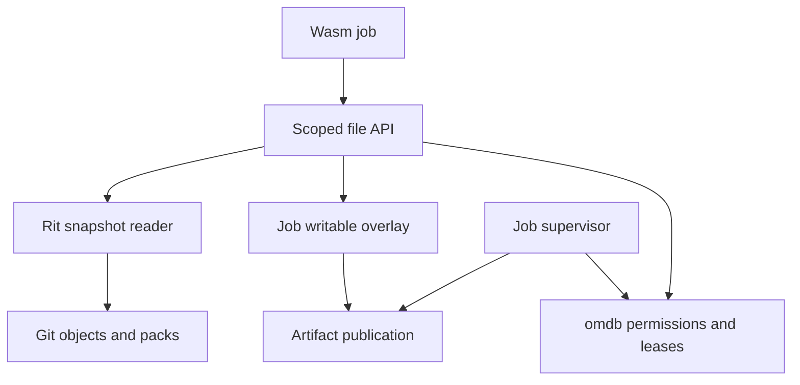

# omdb and redb API fact check

Reviewed November 10, 2026, following Rit's
[`4faf86e` snapshot-reader implementation](https://github.com/glopyglerky/rit/commit/4faf86e79498d1ebf5f385dc5d3bec91b218b266).
This record checks the proposed backend, memory, concurrency, no_std, and Wasmtime
claims against pinned source and local executable probes. It does not activate
a database in Rit or modify the omdb fork.

## Pinned source

| Source | Revision | Status |
| --- | --- | --- |
| Latest release, v4.5.0 | `96ce31fe5cafcf735425a02f1781487a4287e2de` | Published November 5, 2026. |
| Current upstream master | `9273718b3ba5282580ca9035b0fb95b5bf13988f` | Read from GitHub on November 10, 2026. Twenty-three commits ahead of the release. The manifest still says version 4.5.0. |
| User fork, `glopyglerky/omdb`, master | `9273718b3ba5282580ca9035b0fb95b5bf13988f` | Exactly the same commit as upstream master at inspection. No fork-specific changes on this branch at that point. |

Sources: [release](https://github.com/cberner/redb/releases/tag/v4.5.0), [release-to-master comparison](https://github.com/cberner/redb/compare/96ce31fe5cafcf735425a02f1781487a4287e2de...9273718b3ba5282580ca9035b0fb95b5bf13988f), [current manifest](https://github.com/cberner/redb/blob/9273718b3ba5282580ca9035b0fb95b5bf13988f/Cargo.toml).

The fork's repository name is `omdb`, but its Cargo package remains `redb`.
The manifest declares `MIT OR Apache-2.0`. Consumers can use a Cargo dependency
alias named `omdb` while preserving upstream package names and source structure.
These observations come from the [fork manifest at the inspected commit](https://github.com/glopyglerky/omdb/blob/9273718b3ba5282580ca9035b0fb95b5bf13988f/Cargo.toml).

## Main verdict

The three underlying capabilities are real. Both released redb 4.5.0 and current master have `StorageBackend`, `Builder::create_with_backend()`, and `Database::try_begin_write()`. They also have a gated `no_std` build. The supplied trait and memory-backend implementation are not the real current API and would not compile as a redb backend. The conclusions about asynchronous cloud storage, unrestricted concurrent writers, automatic panic configuration, and instant Wasmtime mounting do not follow from these APIs.

### Feature and error-type matrix

| Revision and configuration | Core `StorageBackend` I/O error type | `no_std`? |
| --- | --- | --- |
| v4.5.0, ordinary default configuration | `std::io::Error` | No. `std` is enabled by default. |
| v4.5.0, `experimental-api-5` with `std` enabled | `redb::io::Error`, re-exporting `std::io::Error` | No. |
| v4.5.0, defaults disabled and `experimental-api-5` enabled | `redb::io::Error`, a small message-carrying replacement | Yes, with the other target and panic requirements. |
| Current master, ordinary configuration without `experimental-api-5` | `std::io::Error` | No. |
| Current master, `experimental-api-5` with `std` enabled | `redb::BackendError` | No. |
| Current master, defaults disabled and `experimental-api-5` enabled | `redb::BackendError`, without its `Io` variant | Yes, with the other target and panic requirements. |

Disabling default features without enabling `experimental-api-5` deliberately retains the std build for compatibility. Cargo feature unification can also enable `std` through another dependency, so the resolved feature graph matters.

Sources: [feature definitions](https://github.com/cberner/redb/blob/9273718b3ba5282580ca9035b0fb95b5bf13988f/Cargo.toml), [build-time cfg selection](https://github.com/cberner/redb/blob/9273718b3ba5282580ca9035b0fb95b5bf13988f/build.rs), [v4.5.0 backend trait](https://github.com/cberner/redb/blob/96ce31fe5cafcf735425a02f1781487a4287e2de/src/db.rs#L47-L105), [v4.5.0 io module](https://github.com/cberner/redb/blob/96ce31fe5cafcf735425a02f1781487a4287e2de/src/io.rs), [current backend trait and internal error alias](https://github.com/cberner/redb/blob/9273718b3ba5282580ca9035b0fb95b5bf13988f/src/db.rs#L40-L112).

## What the storage API actually requires

Both revisions have these structural properties:

- The trait requires `'static + Debug + Send + Sync`.
- `read` fills a caller-provided mutable byte slice and returns success or an error. It does not return `Box<[u8]>`.
- `sync_data` takes no `eventual` Boolean argument.
- `set_len` must initialize newly added positions to zero.
- `close` and byte-range locking operations are part of the trait. They have defaults, but multi-process operation requires the appropriate backend locking support.
- Locks belong to backend instances, must conflict across independently opened instances including in the same process, and must be released on close. Backends cannot fake successful locks when no coordination exists.

The interface exposes neither borrowed mmap pages nor futures. A backend can
use mapping, caching, or asynchronous machinery internally, but it must still
satisfy the synchronous byte-operation and durability contracts.

At released v4.5.0, `BackendError` is the separate locking error enum with `Io(io::Error)` and `Unsupported`. There is no `Other` variant. At current master it has `Io(std::io::Error)` in std builds, `Other(Box<dyn core::error::Error + Send + Sync>)`, and `Unsupported`. Neither revision has the supplied enum with `Io(i32)` and `Other(&'static str)`.

Sources: [v4.5.0 trait](https://github.com/cberner/redb/blob/96ce31fe5cafcf735425a02f1781487a4287e2de/src/db.rs#L47-L177), [v4.5.0 BackendError](https://github.com/cberner/redb/blob/96ce31fe5cafcf735425a02f1781487a4287e2de/src/error.rs#L11-L19), [current BackendError](https://github.com/cberner/redb/blob/9273718b3ba5282580ca9035b0fb95b5bf13988f/src/error.rs#L10-L21), [current complete trait](https://github.com/cberner/redb/blob/9273718b3ba5282580ca9035b0fb95b5bf13988f/src/db.rs#L47-L184).

The user-supplied memory backend also lacks the required `Debug` implementation and uses `std::sync::Mutex`, so it is not a `no_std` example. Its unchecked integer conversions and offset additions are unsafe as a storage contract, and allocation or mutex failure can panic. Its `read` clones bytes into a new allocation, which contradicts a zero-copy interpretation. Returning success from its no-op flush is appropriate only for explicitly ephemeral memory storage; it cannot make memory durable.

Upstream already provides `redb::backends::InMemoryBackend`. It is the appropriate starting point for an ephemeral database. It uses a byte vector behind a read/write lock, fills read buffers by copying, and performs no persistent flush. There is no need to copy the inaccurate sample into omdb.

Sources: [public backend export](https://github.com/cberner/redb/blob/9273718b3ba5282580ca9035b0fb95b5bf13988f/src/backends.rs), [actual in-memory backend](https://github.com/cberner/redb/blob/9273718b3ba5282580ca9035b0fb95b5bf13988f/src/tree_store/page_store/backends.rs#L75-L149), [create_with_backend](https://github.com/cberner/redb/blob/9273718b3ba5282580ca9035b0fb95b5bf13988f/src/db.rs#L2458-L2475).

## Durability and remote storage

The current public durability choices are `None` and `Immediate`. Immediate
commits promise persistence when `commit()` returns. The storage design assumes
atomic byte writes, durable data after synchronization, and no damage outside
the bytes being overwritten during a failure. A custom backend must preserve
the relevant guarantees; its method names alone do not establish them.

Sources: [durability modes](https://github.com/cberner/redb/blob/9273718b3ba5282580ca9035b0fb95b5bf13988f/src/transactions.rs#L374-L384), [media assumptions](https://github.com/cberner/redb/blob/9273718b3ba5282580ca9035b0fb95b5bf13988f/docs/design.md#assumptions-about-underlying-media).

An adapter may use a remote service internally, but returning `Ok(())` from
`sync_data()` after only scheduling an upload does not establish remote
durability. A local durable log with asynchronous cloud mirroring can be a
valid design if its acknowledgment promises local durability. Survival of
losing that host needs a different, completed persistence boundary.

Mapping byte offsets onto immutable object-store segments also needs coherent
reads, length changes, ordering, recovery, and an authoritative publication
protocol. Multi-process locking needs real coordination across independent
opens. A mutex around one `Vec` does not provide that protocol. None of the
backend methods provides cross-host replication, consensus, or fencing by
itself. These are requirements inferred from the documented storage and locking
contracts, not features already implemented in the proposed adapter.

## What `try_begin_write` does and does not promise

The v4.5.0 release explicitly introduced `Database::try_begin_write()`. It returns `TransactionError::WouldBlock` when another write transaction holds this database's writer slot, or when a peer process holds the writer transaction in `MultiWriter` mode. There is still only one active write transaction for the database at a time. Concurrent readers and multiple potential writer processes do not mean unrestricted simultaneous write transactions.

This API avoids waiting for the competing writer. It is synchronous. On success it can still refresh state, access storage and acquire other internal locks. It is not an async I/O API, a hard latency bound, or a complete multitenant scheduler. The supplied retry loop blocks the current thread with `sleep`, has no deadline or cancellation, and uses unbounded retries. Those are application choices, not redb guarantees. It cannot be compiled unchanged for `no_std` because it calls `std::thread::sleep`.

Sources: [v4.5.0 release](https://github.com/cberner/redb/releases/tag/v4.5.0), [current acquisition implementation](https://github.com/cberner/redb/blob/9273718b3ba5282580ca9035b0fb95b5bf13988f/src/db.rs#L1868-L1890), [successful acquisition still initializes/synchronizes a transaction](https://github.com/cberner/redb/blob/9273718b3ba5282580ca9035b0fb95b5bf13988f/src/db.rs#L1999-L2038), [single-handle regression](https://github.com/cberner/redb/blob/9273718b3ba5282580ca9035b0fb95b5bf13988f/tests/basic_tests.rs#L350-L377), [peer-writer regression](https://github.com/cberner/redb/blob/9273718b3ba5282580ca9035b0fb95b5bf13988f/tests/multiprocess_tests.rs#L769-L785).

Rust's [thread sleep documentation](https://doc.rust-lang.org/std/thread/fn.sleep.html)
explicitly identifies `std::thread::sleep` as blocking. For an async service,
return a busy outcome to bounded scheduling or use a dedicated database worker.
Keep Git transfer, object decompression, CI execution, and large payload streams
outside the short metadata transaction. This scheduling recommendation does
not turn the database's synchronous I/O into an async API.

## `no_std`, panic behavior, and targets

The supported feature combination removes redb's dependence on the Rust standard library. It still needs `alloc`, an allocator supplied by the final program, and a target with atomic compare-and-swap. Upstream names Cortex-M3 and above as examples and excludes Cortex-M0. This is a build portability capability, not proof of suitable memory use, storage lifetime, or throughput on every device.

The feature does not itself switch the application to panic-abort. Redb emits a compile error when its `no_std` build has unwinding enabled. The consuming application's build must use `panic = "abort"` or a target whose panic strategy already does so. Standard host test harnesses unwind; upstream documents enabling the std feature for those tests and also maintains a separate panic-abort regression executable. The `no_std` synchronization layer uses spinning locks and a spinning notification wait, so `no_std` must not be read as lock-free or scheduler-independent concurrency.

Current documentation says `chrono_v0_4` and `uuid` need std. `cache_metrics` needs 64-bit atomics. The v4.5.0 README called all three unavailable in no_std, while its implementation already rejected cache metrics based on missing 64-bit atomics. The current README is more precise.

Sources: [current README](https://github.com/cberner/redb/blob/9273718b3ba5282580ca9035b0fb95b5bf13988f/README.md#no_std), [feature selection](https://github.com/cberner/redb/blob/9273718b3ba5282580ca9035b0fb95b5bf13988f/build.rs), [panic and atomics compile errors](https://github.com/cberner/redb/blob/9273718b3ba5282580ca9035b0fb95b5bf13988f/src/lib.rs), [no_std synchronization implementation](https://github.com/cberner/redb/blob/9273718b3ba5282580ca9035b0fb95b5bf13988f/src/sync.rs), [separate no_std regression manifest](https://github.com/cberner/redb/blob/9273718b3ba5282580ca9035b0fb95b5bf13988f/crates/redb-no-std-test/Cargo.toml).

Upstream CI configures compile checks for `thumbv7em-none-eabihf` with the no_std feature combination, a host executable that links no_std redb under panic-abort, and separate WASI tests through Wasmtime. The WASI recipe uses `wasm32-wasip1-threads` and ordinary std-enabled tests. These are distinct configurations. They do not prove that no_std automatically creates a WASI filesystem, mounts database pages as repository files, or removes guest/host copying.

Sources: [upstream CI](https://github.com/cberner/redb/blob/9273718b3ba5282580ca9035b0fb95b5bf13988f/.github/workflows/ci.yml), [WASI recipe](https://github.com/cberner/redb/blob/9273718b3ba5282580ca9035b0fb95b5bf13988f/justfile), [Wasmtime runner configuration](https://github.com/cberner/redb/blob/9273718b3ba5282580ca9035b0fb95b5bf13988f/.cargo/config.toml).

The current Rust target name is `wasm32-wasip1`, formerly `wasm32-wasi`.
It supports the standard library with target-specific limits. Thus no_std
is not a prerequisite for running a database application in Wasmtime.
Compilation for a target, linking a usable guest, and executing it with a
qualified storage backend are separate checks.
Source: [Rust WASIp1 target documentation](https://doc.rust-lang.org/rustc/platform-support/wasm32-wasip1.html).

Small memory use is also a separate requirement. The current builder defaults
to a 1 GiB cache budget. That is a configured budget, not a claim that every
database immediately allocates 1 GiB. Constrained deployments must choose and
measure their cache, allocator, and storage limits. Our local probes use an
explicit 1 MiB cache budget.
Source: [builder defaults](https://github.com/cberner/redb/blob/9273718b3ba5282580ca9035b0fb95b5bf13988f/src/db.rs#L2272-L2288).

## The Wasmtime filesystem is a separate adapter

`StorageBackend` reads and writes redb's physical database image. A worker
filesystem must instead provide repository paths, directory entries, file
handles, permissions, file contents, and lifetime rules. These are different
interfaces and different authorities.

Wasmtime's ordinary `preopened_dir` accepts a host directory path. It does not
accept a redb storage backend. Wasmtime's memory read/write methods transfer
data between host buffers and guest linear memory. A custom filesystem or host
API can avoid eagerly copying a whole repository, but direct database pages do
not become guest files automatically, and general zero-copy execution is not
established.

Sources: [Wasmtime directory preopens](https://docs.wasmtime.dev/api/wasmtime_wasi/struct.WasiCtxBuilder.html#method.preopened_dir), [Wasmtime memory](https://docs.wasmtime.dev/api/wasmtime/struct.Memory.html).

For Rit, the proposed connection is a scoped worker API over the existing
[snapshot reader](snapshot-reader.md), with retained object ownership and a
job-owned writable overlay. omdb metadata would track authorization, leases,
job attempts, and publication receipts. Guests should not receive direct
authority over the database image or repository refs.



The diagram is a proposed integration. Only the Git source reader is active
in Rit today. The worker API, retention, overlay, and omdb metadata integration
remain unfinished.

## Adoption consequence

The verified APIs support keeping omdb as a pinned derivative of redb with qualified backends and short transactions. They do not justify replacing the snapshot reader with raw database pages, running jobs inside a write transaction, or calling a queued object-store upload durable.

For Rit's first metadata integration, use the normal std deployment profile.
Keep no_std as a separately qualified portability profile. The server does not
gain a guest filesystem or an async executor by changing database feature
flags. Preserve standard Git object storage while connecting short omdb
transactions for application metadata and rebuildable indexes. Git refs and
database records still need the publication and recovery protocol described in
the [architecture assessment](storage-architecture-review.md).

Use the fork's exact revision as the candidate source identity, with an
upstream-update record, retained tests, and compatibility/crash qualification
before activating it. A Cargo alias can select the fork without renaming the
upstream package throughout its workspace:

```toml
[dependencies]
omdb = { package = "redb", git = "https://github.com/glopyglerky/omdb", rev = "9273718b3ba5282580ca9035b0fb95b5bf13988f" }
```

For a separate no_std evaluation, add `default-features = false` and
`features = ["experimental-api-5"]` to that dependency, configure panic-abort
where required, supply an allocator and backend, and check the resolved feature
graph. This declaration is a reproducible evaluation pin. It is not an edit to
Rit's active manifest or an endorsement of an unqualified production upgrade.

Pin the exact fork commit and resolved features before writing adapters. The preview is already changing after the 4.5.0 release: commits `ae5bc59`, `d16d8d2`, and `337dbeb` changed backend errors and removed `redb::io`; `1e92b55` added no_std read-only database support. Current master also contains post-release corruption fixes, including refusal to recover from a commit slot whose checksum failed and refusal to commit with an undisposed open table. Review and qualify those changes as a named baseline rather than treating every manifest marked 4.5.0 as the same code.

Sources: [23-commit comparison](https://github.com/cberner/redb/compare/96ce31fe5cafcf735425a02f1781487a4287e2de...9273718b3ba5282580ca9035b0fb95b5bf13988f), [checksum recovery fix](https://github.com/cberner/redb/commit/4e18e632dec36210929540b3e8d072f40944b06c), [open-table commit fix](https://github.com/cberner/redb/commit/9273718b3ba5282580ca9035b0fb95b5bf13988f).

## Executed API checks

Local checks used Lustr `6339fbb104d6adda4be7e6be7dc637a6a9e5586b`, its explicit
rustc route, and Rust 1.99.1 at
`58cf8f9c35b355199727627d07ae34a4e2846d67`. They ran offline against the clean
omdb checkout at `9273718`, with warnings denied.

| Probe | Observed result |
| --- | --- |
| Default std profile | Build and execution passed. |
| Defaults disabled, API-5 preview, panic-abort | Build and execution passed on the host. |
| Supplied memory backend adapted to import the real trait | Compiler rejected four API mismatches: read, sync_data, Debug, and the Other payload. |
| no_std with panic-unwind | Compiler rejected it with redb's explicit panic-strategy error. |
| Default features disabled without API-5 preview | Build and execution passed with unwind, confirming the compatibility std path. |

Both runtime configurations checked the existing in-memory backend, a busy
outcome while a write transaction is held, successful acquisition after it is
released, exact committed byte values, and old/new read-transaction snapshots.
The no_std build output explicitly emitted `redb_no_std`, and the feature graph
showed the preview feature without redb's std feature.

The host runner still uses std and supplies the runtime/allocator. Its
target-specific libc dependency also has its own std feature. This is evidence
that the selected redb dependency can run in no_std mode on a host, not a
whole-program bare-metal or Wasm qualification. No cloud backend, crash test,
multi-process runtime test, full upstream test suite, performance benchmark,
or physical-device test was executed for this fact check. The released 4.5.0
source was compared but not built in these probes.

Complete [results and hashes](omdb-factcheck-evidence/result.json),
[executed probe source](omdb-factcheck-evidence/probe-source.md),
[default runtime log](omdb-factcheck-evidence/default-std.log),
[no_std runtime log](omdb-factcheck-evidence/no-std-abort.log), and
[rejected pasted-code diagnostics](omdb-factcheck-evidence/pasted-signature-failure.log)
are retained. The following function is the tested try-once implementation;
its caller owns retry scheduling and cancellation:

```rust
use omdb::{Database, Error, TableDefinition, TransactionError};

const REPO_METADATA: TableDefinition<&str, &[u8]> =
    TableDefinition::new("repo_metadata");

#[derive(Debug, PartialEq, Eq)]
pub enum WriteOutcome {
    Committed,
    Busy,
}

pub fn try_put(db: &Database, key: &str, value: &[u8]) -> Result<WriteOutcome, Error> {
    let write = match db.try_begin_write() {
        Ok(write) => write,
        Err(TransactionError::WouldBlock) => return Ok(WriteOutcome::Busy),
        Err(error) => return Err(error.into()),
    };
    {
        let mut table = write.open_table(REPO_METADATA)?;
        table.insert(key, value)?;
    }
    write.commit()?;
    Ok(WriteOutcome::Committed)
}
```

Create an ephemeral database using the existing backend:

```rust
let db = omdb::Database::builder()
    .set_cache_size(1024 * 1024)
    .create_with_backend(omdb::backends::InMemoryBackend::new())?;
```

The success path remains synchronous. The example supplies no cross-tenant
authorization, durable cloud storage, or worker sandbox by itself.
